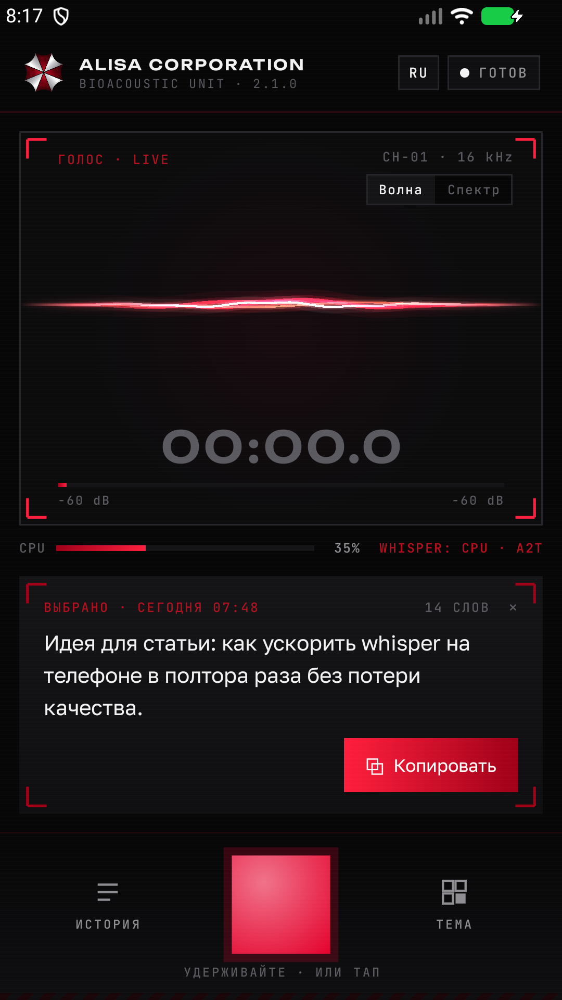
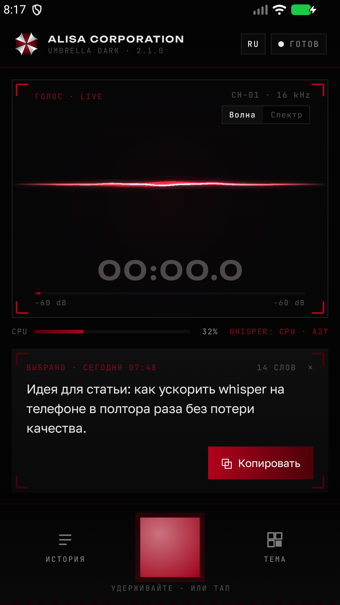
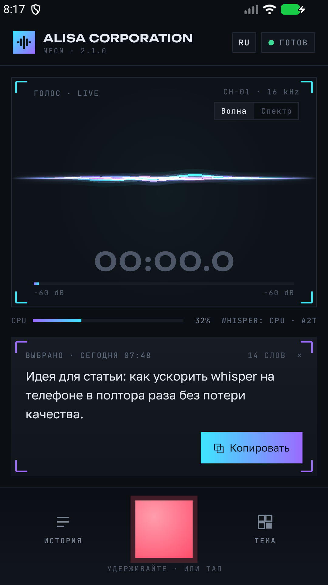
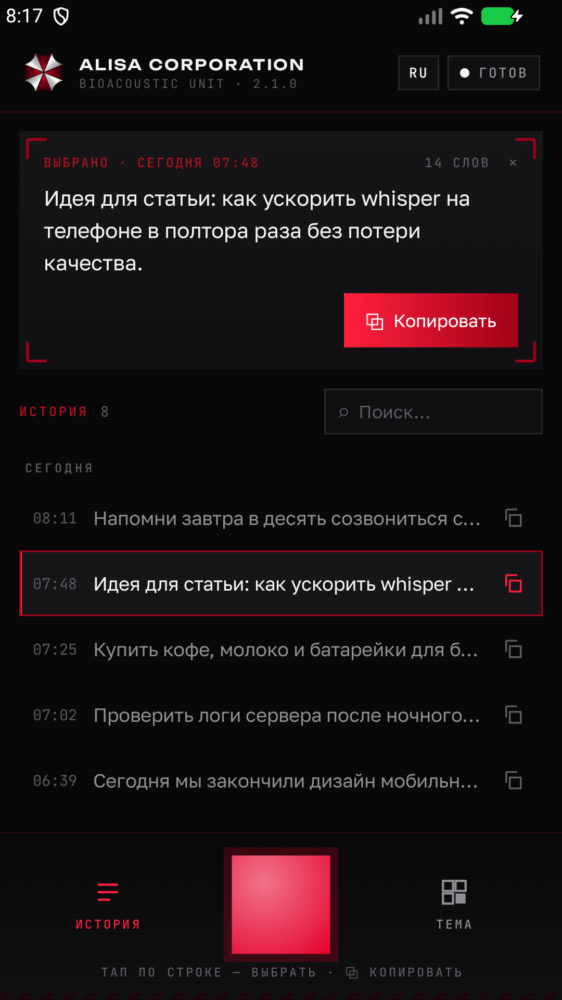

# ALISA CORPORATION · BIOACOUSTIC UNIT — Android

**VOICIFY 2.1.0** — offline push-to-talk speech-to-text for Android on [whisper.cpp](https://github.com/ggerganov/whisper.cpp).
Hold the button, speak, release: the text is recognised on the phone and copied to the clipboard.
Companion of the desktop app [alisacorporation/bioacoustic](https://github.com/alisacorporation/bioacoustic) — same design, same history format.

| Umbrella | Umbrella Dark | Neon | History |
|---|---|---|---|
|  |  |  |  |

<sub>Screenshots use demo data.</sub>

## Features

- **Hold to talk** or **tap** for hands-free (tap again to stop); a short post-roll keeps the last word when you let go early
- live visualisation: neon sine waves or FFT spectrum; animated emblem record button
- three themes: **Neon**, **Umbrella**, **Umbrella Dark**
- transcription card with corner readouts (word count · audio length · whisper time · threads), one-tap copy
- searchable history (desktop-compatible JSON), tap to pin an entry
- CPU load bar and a thread switch (auto / 4 / 6 / 8) for tuning on your device
- **no internet permission** — audio and text never leave the phone

## Speed

whisper runs on the CPU, tuned for modern ARM phones:

- native code always built `-O3` (even in debug APKs) with `armv8.2-a+dotprod+fp16`
- the encoder only processes the length of the phrase (`audio_ctx`) instead of a fixed 30 s window
- `ggml-large-v3-turbo-q4_0.bin` is preferred: ggml repacks q4_0 for ARM dot-product kernels, ~1.5× faster than q5_0 with the same text

## Models

Put a `ggml-*.bin` model into **Downloads** and grant *All files access* once — the app finds it by itself
(order: large-v3-turbo q4_0 → other large-v3-turbo → small → anything). Or use **"Выбрать файл модели"** to import one.

Models: <https://huggingface.co/ggerganov/whisper.cpp>. To make the recommended q4_0 turbo yourself:

```bash
cd whisper.cpp
sh models/download-ggml-model.sh large-v3-turbo
cmake -B build && cmake --build build -j --target whisper-quantize
./build/bin/whisper-quantize models/ggml-large-v3-turbo.bin models/ggml-large-v3-turbo-q4_0.bin q4_0
```

## Build

```bash
git clone --recursive https://github.com/alisacorporation/bioacoustic-android
cd bioacoustic-android
./gradlew :app:assembleDebug          # → app/build/outputs/apk/debug/app-debug.apk
```

Requires Android SDK + NDK 25.2 (set `sdk.dir` in `local.properties`). whisper.cpp is a git submodule pinned to a tested commit.
ABIs: `arm64-v8a` (phones) and `x86_64` (emulator).

## License

MIT — see [LICENSE](LICENSE). Based on the `examples/whisper.android` project of whisper.cpp.
